# YTDL Flow

  <strong>Local YouTube downloader for audio and video</strong> 
  Download MP3, MP4, and other formats from YouTube with a secure localhost web UI, queue management, metadata embedding, and real-time progress tracking.

  
  
  
  
  

*Media discovery → format selection → queue → download → verification → history/status*

