<div align="center">



# YTDL Flow

<p align="center">
  <strong>Local YouTube downloader for audio and video</strong><br>
  Download MP3, MP4, and other formats from YouTube with a secure localhost web UI or Windows desktop app, queue management, metadata embedding, and real-time progress tracking.
</p>

<p align="center">
  <a href="https://react.dev/"></a>
  <a href="https://nodejs.org/"></a>
  <a href="https://www.python.org/"></a>
  <a href="https://github.com/yt-dlp/yt-dlp"></a>
  <a href="https://www.ffmpeg.org/"></a>
</p>

<p align="center">
  <a href="https://www.typescriptlang.org/"></a>
  <a href="LICENSE"></a>
  <a href="https://github.com/nishanth-kkj9/ytdl-flow/issues"></a>
</p>

*Media discovery → format selection → queue → download → processing → verification → history/status*

</div>

---

## Table of Contents

- [Quick Overview](#quick-overview)
- [Features](#features)
- [Technology Stack](#technology-stack)
- [System Architecture](#system-architecture)
- [Installation](#installation)
- [Getting Started](#getting-started)
- [API Reference](#api-reference)
- [Project Structure](#project-structure)
- [Security Considerations](#security-considerations)
- [Deployment & CI/CD](#deployment--cicd)
- [Troubleshooting](#troubleshooting)
- [Documentation](#documentation)
- [Contributing](#contributing)
- [License](#license)

---

## Quick Overview

YTDL Flow is a **localhost-only** YouTube downloader that runs entirely on your machine. It provides:

- **Web UI** at `http://127.0.0.1:3000` for probing, downloading, and managing history
- **Windows desktop app** with a native download-folder picker (optional)
- **REST API** for programmatic access
- **WebSocket** for real-time progress and status updates
- **Concurrent downloads** (up to 5 workers) with full queue management
- **Automatic metadata embedding** (title, artist, cover art, etc.)
- **Format verification** to ensure output codec matches your selection
- **Multi-client bot detection bypass** using iOS, Android, and web YouTube clients

### Key Design Principles

- **Security-first:** Binds to localhost only; enforces Host header validation and URL allowlisting
- **Modular architecture:** Frontend (React), backend (Express), and engine (Python) communicate over well-defined contracts (REST, WebSocket, NDJSON)
- **Production-grade:** Comprehensive test coverage, CI/CD via GitHub Actions, type-safe code (TypeScript + Python type hints)
- **Operator-friendly:** Detailed logging, status API, live engine diagnostics panel

---

## Features

### Audio Downloads
- **Formats:** MP3, Opus, M4A/AAC, WAV
- **Quality presets:** Maximum, High, Medium, Low
- **Metadata:** Embeds title, artist, album, release date, genre, and cover art

### Video Downloads
- **Formats:** MP4, WebM, MKV
- **Resolutions:** 4K (2160p), 1080p, 720p, 480p, 360p, plus quality presets (Maximum, Best, High, Medium, Low)
- **Metadata:** Embeds title and description

### Advanced Features
- **Probe:** Fetch metadata (title, uploader, duration, thumbnail, available formats) before downloading
- **Trim:** Optional start/end trim (seconds or `HH:MM:SS` / `MM:SS` format) via FFmpeg
- **Format verification:** Post-download readback confirms codec and stream info
- **Cover art:** Fetches and embeds highest-resolution YouTube thumbnail automatically
- **Download queue:** Multiple concurrent downloads with cancel and retry capabilities
- **Live progress:** Real-time speed, ETA, animated waveform visualizations
- **Download history:** Persistent log (capped at 100 records) with file open/reveal
- **Bot detection bypass:** Uses multiple YouTube player clients for reliable extraction
- **Engine diagnostics:** Live event panel showing real-time debug logs and warnings

---

## Technology Stack

| Layer | Technology |
|-------|------------|
| **Frontend** | React 19, TypeScript 5.6, Zustand, Tailwind CSS v4, Vite 6 |
| **Desktop host** | Electron 45 (Windows x64 installer) |
| **Backend** | Node.js 18+ web runtime, Express 5.2, WebSocket (`ws` library) |
| **Engine** | Python 3.9+, yt-dlp, mutagen, FFmpeg |
| **Optional** | Deno (JS runtime for yt-dlp's age-restricted video extraction) |
| **Testing** | Vitest (frontend), node:test (backend), pytest (Python engine) |
| **CI/CD** | GitHub Actions (lint, type-check, test, smoke tests, release builds) |

---

## System Architecture

```text
┌─────────────────┐
│   Browser UI    │ (React 19 + Zustand + Tailwind)
│   localhost:3000│
└────────┬────────┘
         │ HTTP + WebSocket
         ▼
┌─────────────────────────────────────────┐
│      Node.js / Express (port 3000)      │
├─────────────────────────────────────────┤
│  • URL validation & sanitization        │
│  • REST routes (probe, download, etc.)  │
│  • WebSocket event broadcast            │
│  • EngineManager (process orchestration)│
├─────────────────────────────────────────┤
│  NDJSON stdin/stdout IPC                │
└────────────┬────────────────────────────┘
             │
             ▼
┌──────────────────────────────────────────┐
│  Python Engine (ipc_main.py)             │
├──────────────────────────────────────────┤
│  • ThreadPoolExecutor (5 download workers)
│  • AudioDownloadEngine (engine.py)       │
│    - yt-dlp for format extraction       │
│    - mutagen for metadata embedding     │
│    - FFmpeg for audio/video processing  │
│  • Retry logic & error handling         │
│  • File logging with rotation           │
└──────────────────────────────────────────┘
```

**Data Flow:**
1. User submits URL via web UI
2. REST POST to `/api/probe` returns a request ID
3. Engine processes asynchronously; WebSocket broadcasts metadata and progress events
4. Frontend updates UI in real-time using Zustand store
5. History persisted to JSON file on successful completion

---

## Installation

### Prerequisites

- **Node.js** 18+ ([install](https://nodejs.org/))
- **Python** 3.9+ ([install](https://www.python.org/))
- **FFmpeg** — must be on your `PATH`, or set `FFMPEG_PATH` / `FFMPEG_HOME` environment variable
  - macOS: `brew install ffmpeg`
  - Ubuntu/Debian: `sudo apt-get install ffmpeg`
  - Windows: Download from [ffmpeg.org](https://ffmpeg.org/download.html) or `choco install ffmpeg`
- **Deno** (optional) — for yt-dlp's JS runtime, used for age-restricted videos
  - Install from [deno.land](https://deno.land/)

### Step 1: Clone the Repository

```bash
git clone https://github.com/nishanth-kkj9/ytdl-flow.git
cd ytdl-flow
```

### Step 2: Install Frontend Dependencies

```bash
npm install
```

### Step 3: Install Backend Dependencies

```bash
cd web && npm install && cd ..
```

### Step 4: Install Python Engine Dependencies

**Recommended:** Use a virtual environment to keep dependencies isolated:

```bash
python -m venv .venv
# Windows PowerShell:
.\.venv\Scripts\Activate.ps1
# macOS/Linux:
source .venv/bin/activate
pip install -r python-engine/requirements.lock
```

Or install from unpinned ranges (allows patch updates):

```bash
pip install -r python-engine/requirements.txt
```

### Step 5: (Optional) Copy Environment Config

```bash
# macOS/Linux:
cp .env.example .env
```

On Windows PowerShell, use `Copy-Item .env.example .env`. See
[.env.example](.env.example) for supported options and their defaults.

---

## Getting Started

### Production Mode

```bash
# Build frontend + start server
npm run build && npm run server
```

By default, visit **http://127.0.0.1:3000** in your browser. The server uses
the loopback interface and port 3000 unless configured otherwise.

### Development Mode

To start the backend and frontend together:

```bash
npm run dev:all
```

Or run them separately:

**Terminal 1 — Backend with auto-restart:**
```bash
cd web && npm run dev
```

**Terminal 2 — Frontend with hot module replacement:**
```bash
npm run dev
```

Then visit **http://127.0.0.1:5173** (Vite dev server).

The Vite dev server automatically proxies `/api`, `/downloads`, and `/ws` to the backend on port 3000.

### Windows Desktop App

The optional Windows x64 desktop host serves the same built React app from a
loopback-only Node server. The NSIS installer bundles Electron and the
PyInstaller-built Python engine. **FFmpeg/ffprobe are not bundled**; install
FFmpeg separately and make it available on `PATH`, or configure
`FFMPEG_PATH`/`FFMPEG_HOME`. Deno and YouTube cookies remain optional
user-managed prerequisites.

To develop or build the installer on Windows, use Node.js 24 and Python 3.11:

```powershell
npm ci
cd web
npm ci
cd ..
python -m pip install -r python-engine/requirements.lock
python -m pip install -r python-engine/requirements-build.txt
npm run desktop:dev
```

`npm run desktop:dev` builds the frontend and opens the desktop host. To create
an installer instead, run `npm run desktop:dist`; the NSIS installer is written
to `release/`. `npm run desktop:pack` creates an unpacked Windows app directory
for packaging checks. The release workflow also builds and attaches the Windows
installer to tagged GitHub releases.

The desktop app stores settings, history, and logs in Electron's per-user data
directory. Its header folder button opens a native directory picker; changing
the folder is refused while the backend reports active jobs. Web mode and its
default paths remain unchanged.

### Running Tests

```bash
# Frontend (Vitest)
npm test

# Frontend with watch mode
npm run test:watch

# Frontend lint + type-check
npm run lint
npx tsc --noEmit

# Backend (node:test)
cd web && npm test

# Python engine (pytest)
cd python-engine && python -m pytest tests -v

# Integration smoke tests (server must be running)
npm run test:smoke
```

---

## API Reference

The server defaults to **localhost-only** at `127.0.0.1:3000`. The port can be
changed with `PORT`; see [.env.example](.env.example) for configuration notes.

### Health & Status

| Method | Endpoint | Description |
|--------|----------|-------------|
| `GET` | `/api/health` | Server liveness and engine readiness (`ok`, `engineReady`) |
| `GET` | `/api/status` | Engine readiness, tool availability, active jobs, versions, uptime |
| `POST` | `/api/engine/restart` | Restart the engine after a fatal error |

### Probe

**Fetch video metadata before downloading.**

```bash
curl -X POST http://127.0.0.1:3000/api/probe \
  -H "Content-Type: application/json" \
  -d '{"url": "https://www.youtube.com/watch?v=dQw4w9WgXcQ"}'
```

**Response:** `{ "id": "uuid-string" }`

Actual result arrives asynchronously over WebSocket as `probe_result` event.

### Download

**Start a download job.**

```bash
curl -X POST http://127.0.0.1:3000/api/download \
  -H "Content-Type: application/json" \
  -d '{
    "url": "https://www.youtube.com/watch?v=dQw4w9WgXcQ",
    "mode": "audio",
    "format": "mp3",
    "quality": "high"
  }'
```

**Response:** `{ "id": "download-id" }`

Progress and result events arrive over WebSocket.

#### Parameters

| Field | Required | Default | Options |
|-------|----------|---------|---------|
| `url` | Yes | — | Any YouTube URL (see Accepted URLs below) |
| `mode` | No | `"audio"` | `"audio"`, `"video"` |
| `format` | No | `"mp3"` | Audio: `mp3`, `opus`, `m4a`, `aac`, `wav` · Video: `mp4`, `webm`, `mkv` |
| `quality` | No | `"high"` | Audio: `maximum`, `high`, `medium`, `low` · Video: `maximum`, `best`, `2160p`, `1080p`, `720p`, `480p`, `360p`, `high`, `medium`, `low` |
| `id` | No | auto | Client-side tracking ID |
| `trim_start` / `trim_end` | No | — | Trim window in seconds or `HH:MM:SS` / `MM:SS`; requires FFmpeg |

#### Optional Metadata Fields

You can pass additional metadata to override YouTube's data:

```json
{
  "url": "...",
  "title": "Custom Title",
  "uploader": "Custom Artist",
  "thumbnail": "https://...",
  "duration": 180,
  "webpage_url": "..."
}
```

#### Accepted URLs

- `youtube.com/watch?v=...`
- `youtu.be/...`
- `youtube.com/shorts/...`
- `youtube.com/embed/...`
- `youtube.com/v/...`
- `youtube.com/live/...`
- `music.youtube.com/watch?v=...`
- `m.youtube.com/...` (mobile subdomain)

### Cancel Download

```bash
curl -X POST http://127.0.0.1:3000/api/download/cancel \
  -H "Content-Type: application/json" \
  -d '{"id": "download-id"}'
```

### History

| Method | Endpoint | Description |
|--------|----------|-------------|
| `GET` | `/api/history?limit=100&offset=0` | List download history (max 200 per page) |
| `POST` | `/api/history` | Validate and save a history record |
| `DELETE` | `/api/history` | Clear all history records |

Successful downloads are also persisted by the server, so history does not
depend on the browser tab remaining open.

### WebSocket Events

Connect to `ws://127.0.0.1:3000/ws` for real-time server-to-client events.

| Event | Payload | Description |
|-------|---------|-------------|
| `engine_ready` | `{ protocol_version, ffmpeg, ffprobe, deno, yt_dlp, mutagen }` | Engine started; tool availability |
| `engine_error` | `{ error }` | Engine startup error |
| `probe_result` | `{ id, success, info }` | Probe completed with metadata |
| `download_started` | `{ id, url, fmt, quality }` | Download acknowledged |
| `progress` | `{ id, status, downloaded, total, speed, eta }` | Real-time progress |
| `result` | `{ id, success, title, filepath, warnings }` | Download completed or failed |
| `cancelled` | `{ id }` | Download cancelled by user |
| `error` | `{ id, error_type, error }` | Per-request error |
| `download_retry` | `{ id, attempt, delay_seconds, error }` | Engine is retrying a download |
| `fatal_error` | `{ error }` | Engine entered a fatal-error state |
| `engine_crashed` | `{ exit_code, signal }` | Engine process exited unexpectedly |
| `engine_log` | `{ message }` | Raw engine output (debug level) |

---

## Project Structure

```text
ytdl-flow/
├── src/                           # React frontend (TypeScript + Tailwind)
│   ├── components/                # Reusable UI components
│   ├── api/
│   │   └── transport.ts           # WebSocket + REST client
│   ├── hooks/
│   │   └── useEngineEvents.ts     # WebSocket event routing hook
│   ├── stores/
│   │   └── downloadStore.ts       # Zustand state management
│   ├── test/
│   │   └── setup.ts               # Vitest configuration
│   ├── App.tsx                    # Root component
│   ├── main.tsx                   # Entry point
│   ├── types.ts                   # Shared TypeScript types
│   ├── utils.ts                   # Helper functions
│   ├── styles.css                 # Tailwind global styles
│   └── *.test.ts                  # Unit tests
│
├── web/                           # Node.js / Express backend
│   ├── middleware/                # Security, request logging, static serving
│   ├── routes/                    # REST endpoint handlers
│   ├── services/
│   │   ├── engineManager.mjs      # Manages Python engine lifecycle
│   │   ├── historyService.mjs     # Persists/loads download history
│   │   └── ...
│   ├── eventBus.mjs               # Internal event emitter
│   ├── server.mjs                 # Express + WebSocket bootstrap
│   ├── config.mjs                 # Environment & config loader
│   ├── validate.mjs               # Request validation helpers
│   ├── tests/
│   │   └── *.test.mjs             # Unit & integration tests
│   └── package.json
│
├── python-engine/                 # Python download engine
│   ├── engine.py                  # Probe, download, metadata, and FFmpeg work
│   ├── ipc_main.py                # NDJSON IPC command dispatcher
│   ├── logger.py                  # File logging with rotation
│   ├── helpers.py                 # Sanitization, format utilities
│   ├── tests/
│   │   └── test_*.py              # pytest test suite
│   ├── requirements.lock          # Pinned + hash-locked deps (production)
│   ├── requirements.txt           # Unpinned ranges (development)
│   └── requirements-dev.txt       # Dev extras (pytest, etc.)
│
├── .github/
│   └── workflows/
│       ├── ci.yml                 # Lint, type-check, test, smoke tests
│       └── release.yml            # Build & publish release archives
│
├── scripts/
│   ├── dev-all.mjs                # Orchestrate frontend + backend together
│   └── ...
│
├── desktop/                       # Electron main process, preload, backend runner
├── public/branding/                # Web icon derivative and Windows ICO
├── test-smoke.mjs                 # Integration smoke tests
├── eslint.config.js               # ESLint configuration
├── tsconfig.json                  # TypeScript configuration
├── vite.config.ts                 # Vite build configuration
├── postcss.config.js              # PostCSS (Tailwind) config
├── package.json                   # Root package (frontend)
├── .env.example                   # Environment template
├── README.md                      # This file
├── CONTRIBUTING.md                # Contribution guidelines
└── LICENSE                        # MIT License
```

---

## Security Considerations

YTDL Flow implements **defense-in-depth** security controls:

| Control | Implementation | Rationale |
|---------|---------------|-----------|
| **Loopback defaults** | Defaults to `127.0.0.1`; validates loopback Host headers | Keeps the intended local-only access model |
| **Electron isolation** | Context isolation, sandboxing, no renderer Node access, narrow preload API, trusted-frame validation | Keeps native folder selection behind the main-process boundary |
| **Host header validation** | Rejects requests with invalid `Host` header | Blocks DNS rebinding attacks |
| **URL allowlist** | Only `youtube.com` and `youtu.be` domains | Prevents arbitrary URL downloads |
| **Path containment** | Resolves symlinks and confines engine output to the configured download directory | Helps prevent path traversal |
| **Thumbnail URL validation** | Restricts thumbnail fetches to known YouTube media/CDN hosts | Helps prevent server-side request forgery |
| **Bounded work** | Limits download concurrency and queued engine commands | Reduces resource-exhaustion risk |
| **Input validation** | Validates URLs, format options, identifiers, and metadata lengths | Rejects malformed or oversized input |
| **JSON body limit** | Express request body capped at 1 MB | Limits oversized request bodies |
| **Filename sanitization** | Removes Windows reserved names (CON, PRN, AUX, etc.) | Prevents Windows filesystem issues |

---

## Deployment & CI/CD

### GitHub Actions Workflows

#### `ci.yml` (Runs on push/PR to main)

1. **Frontend** — Install → Vitest → ESLint → TypeScript check → Production build
2. **Backend** — Install → Syntax checks → `node:test` suite
3. **Python Engine** — Install from lock file → Compile check → Import verification → pytest
4. **Smoke Tests** — Start server → Check health, history, invalid-probe handling, and DNS-rebinding protection; the live integration probe is opt-in
5. **Tagged releases** — Build the existing web archives and a Windows x64 NSIS desktop installer

#### `release.yml` (Runs on `v*` tags)

1. Build frontend to `dist/`
2. Create release archives (tar.gz + zip)
3. Publish GitHub Release with attachments

### Environment Variables

See `.env.example` for all available options:

| Variable | Purpose | Default |
|----------|---------|---------|
| `PORT` | HTTP server port | `3000` |
| `HOST` | Server bind address; keep the loopback default | `127.0.0.1` |
| `YTDL_DATA_DIR` | Persistent history data directory (not the downloads folder) | `web/data` |
| `YTDL_DOWNLOADS_DIR` | Download destination (also used by Python path containment) | `downloads/` |
| `YTDL_LOG_DIR` | Python engine log directory | `logs/` |
| `PYTHON` | Python executable used to launch the engine | `python` |
| `ENGINE_MAX_PENDING` | Maximum pending engine commands | `100` |
| `FFMPEG_PATH`, `FFMPEG_HOME` | Optional FFmpeg locations | Auto-detected |
| `DENO_PATH` | Optional Deno executable location | Auto-detected |
| `YTDL_COOKIES_FILE`, `YTDL_COOKIES_BROWSER` | Optional yt-dlp cookie authentication source | Unset |

Do not commit cookie files or other credentials. The example file documents
the security considerations for optional YouTube authentication.

---

## Troubleshooting

### FFmpeg Not Found

**Symptom:** Engine shows `ffmpeg=no` in status; format verification fails.

**Solution:**
1. Ensure FFmpeg is installed and on your `PATH`: `ffmpeg -version`
2. Set `FFMPEG_PATH` or `FFMPEG_HOME` in `.env` if not on PATH
3. Restart the server

### Engine Crashes on Startup

**Symptom:** Server logs show immediate crash.

**Solution:**
1. Check `logs/ytdl_pro_*.log` (Python file logger with daily rotation)
2. Check the `web` server console output
3. Use the "Restart engine" button in the live log panel (advanced diagnostics)

### Windows Desktop App Cannot Start

**Symptom:** The installer opens an error dialog or downloads fail in the
desktop app.

**Solution:**
1. Confirm the installer is for 64-bit Windows.
2. Install FFmpeg and ffprobe and verify `ffmpeg -version` works in a new
   terminal, or set `FFMPEG_PATH`/`FFMPEG_HOME` in the Windows user environment.
3. Check the app's `logs` folder under Electron's per-user data directory for
   Python engine diagnostics.

### Python Dependency Conflicts

**Symptom:** `ImportError` or version mismatches in engine logs.

**Solution:**
1. Create a fresh virtual environment:
   ```bash
   python -m venv .venv
   # Windows PowerShell:
   .\.venv\Scripts\Activate.ps1
   # macOS/Linux:
   source .venv/bin/activate
   ```
2. Install from the pinned lock file:
   ```bash
   pip install -r python-engine/requirements.lock
   ```
3. Restart the server

### Port 3000 Already in Use

**Symptom:** `EADDRINUSE: address already in use :::3000`

**Solution:**
```bash
# Set PORT before starting
export PORT=3100  # or: $env:PORT=3100 on Windows
npm run server
```

Then visit `http://127.0.0.1:3100`.

### Stale UI After Rebuild

**Symptom:** Changes not reflected in the browser.

**Solution:**
1. Run `npm run build` to rebuild the frontend
2. Restart the server: `npm run server`
3. Hard-refresh your browser: `Ctrl+Shift+R` (or `Cmd+Shift+R` on macOS)

### Download Fails with Format Error

**Symptom:** Download succeeds but format verification fails.

**Solution:**
1. Check engine logs in the live log panel
2. Verify FFmpeg is installed and working: `ffprobe -version`
3. Try a different quality/format preset
4. Open an issue with the download URL and format selected

---

## Documentation

Beyond this README, the repository ships a documentation set maintained for humans and coding agents alike:

| Document | Contents |
|----------|----------|
| [AGENTS.md](AGENTS.md) | Binding rules for coding agents (branding policy, reference hierarchy, verification gates) |
| [docs/product.md](docs/product.md) | What YTDL Flow is, target users, core media workflow, CURRENT/PLANNED/FUTURE direction |
| [docs/architecture.md](docs/architecture.md) | Canonical three-tier architecture overview with end-to-end flow diagrams |
| [docs/design-system.md](docs/design-system.md) | Verified design tokens (colors, typography, radii, motion) from `src/styles.css` |
| [docs/branding.md](docs/branding.md) | Official visual identity, logo rules and usage policy |
| [docs/roadmap.md](docs/roadmap.md) | Completed / In Progress / Planned / Ideas — evidence-based roadmap |
| [docs/decisions.md](docs/decisions.md) | ADR-style decision log for architecture and product choices |
| [docs/codebase/](docs/codebase) | Deep technical reference: architecture, stack, structure, conventions, testing, integrations, concerns |
| [plans/](plans/README.md) | Numbered implementation plans (001–006) with execution records |
| [references/branding/](references/branding/README.md) | **The authoritative YTDL Flow logo** (vector SVG, source of truth) |

---

## Contributing

Thank you for your interest in contributing! Please read [CONTRIBUTING.md](CONTRIBUTING.md) for:

- Setup instructions
- Development workflow
- Testing guidelines
- Code style conventions
- Pull request process

**Quick start:**

```bash
git clone https://github.com/nishanth-kkj9/ytdl-flow.git
cd ytdl-flow
npm install && cd web && npm install && cd ..
python -m venv venv && source venv/bin/activate
pip install -r python-engine/requirements.lock
node scripts/dev-all.mjs  # Run everything together
```

---

## License

MIT License — see [LICENSE](LICENSE) for details.

By contributing, you agree that your contributions will be licensed under the same terms.

---

## Acknowledgments

- **yt-dlp** — Robust YouTube extraction with multi-client support
- **React 19** — Modern UI framework with concurrent rendering
- **Express 5** — Lightweight, modular web framework
- **FFmpeg** — Powerful audio/video processing
- **Tailwind CSS** — Utility-first styling
- **Zustand** — Minimalist state management

---

**Questions?** Open an [issue](https://github.com/nishanth-kkj9/ytdl-flow/issues) or [discussion](https://github.com/nishanth-kkj9/ytdl-flow/discussions).
